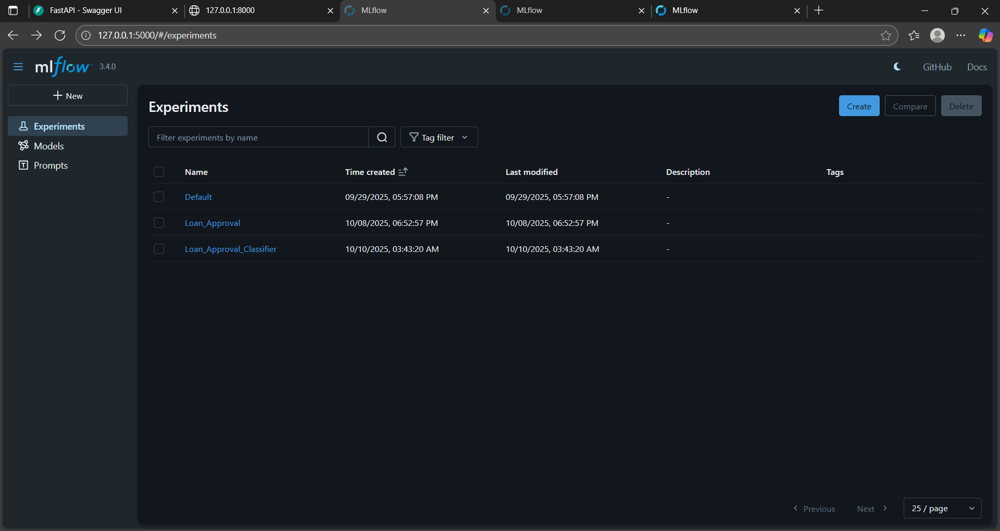

# Loan Approval Prediction

A machine learning project that predicts whether a loan application will be **approved or rejected** using a **Random Forest** classifier (**98.13% accuracy**). The model is served through a **FastAPI** REST API, containerized with **Docker**, and experiments are tracked with **MLflow**.

## Features
- Random Forest model trained on a loan applications dataset
- REST API with a `/predict` endpoint (FastAPI)
- Interactive API docs via Swagger UI
- Experiment tracking with MLflow
- Ready to run with Docker

## Tech Stack
Python, Pandas, NumPy, Scikit-learn, XGBoost, FastAPI, Uvicorn, MLflow, Matplotlib, Seaborn, Docker

## Project Structure
```
Loan-Approval/
├── main.py                  # FastAPI application
├── rf_model.pkl             # Trained Random Forest model
├── FINAL_CLS.ipynb          # EDA, training and evaluation notebook
├── loan_approval_dataset.csv
├── requirements.txt
├── Dockerfile
├── lpd.png                  # Screenshot
└── testing.mp4              # Demo video
```

## Getting Started

### Run locally
```bash
git clone https://github.com/moohamedkishk10/Loan-Approval.git
cd Loan-Approval
pip install -r requirements.txt
uvicorn main:app --reload
```
Open the docs at: http://127.0.0.1:8000/docs

### Run with Docker
```bash
docker build -t loan-approval .
docker run -p 8000:80 loan-approval
```
Open the docs at: http://127.0.0.1:8000/docs

## API Usage

**POST** `/predict`

Request body:
```json
{
  "no_of_dependents": 2,
  "education": "Graduate",
  "self_employed": "No",
  "income_annum": 9600000,
  "loan_amount": 29900000,
  "loan_term": 12,
  "cibil_score": 778,
  "residential_assets_value": 2400000,
  "commercial_assets_value": 17600000,
  "luxury_assets_value": 22700000,
  "bank_asset_value": 8000000
}
```

Response:
```json
"Approved"
```

## Model Performance
| Model | Accuracy |
|-------|----------|
| Random Forest | **98.13%** |

## Demo


[Watch the demo video](testing.mp4)

## Author
**Mohamed Mahmoud Kishk**
GitHub: [@moohamedkishk10](https://github.com/moohamedkishk10)